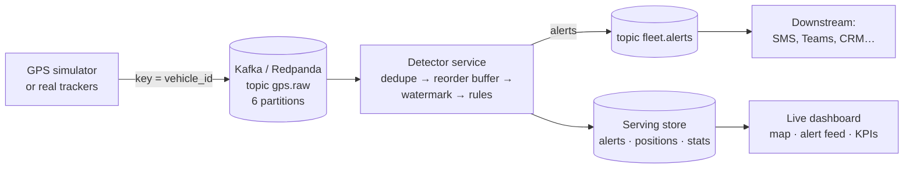

# 📡 Fleet GPS Streaming: Real-time Anomaly Detection

**Detect overspeeding, long idling, lost signal, restricted-zone entry, GPS glitches and harsh braking
the moment they happen, from a live stream of vehicle GPS pings.** Built on Kafka (Redpanda), with
event-time processing, deduplication, late-event handling, idempotent alerts and a live map dashboard.

> Data: a built-in simulator drives a fleet around real Dubai locations, sending a GPS ping every 10
> seconds per vehicle, and injects labelled anomalies plus network noise (duplicates and out-of-order
> delivery). Because every anomaly is labelled, detection quality can be **measured**, not guessed.

---

## Why it matters

Batch reports tell a fleet manager what went wrong yesterday. Streaming tells them while they can still act:
call the driver who is speeding, check the van that has idled for 20 minutes, or find the truck whose tracker
went silent near the port.

| Alert | What it means for the business |
|---|---|
| Overspeeding (sustained) | Safety, fines, insurance cost |
| Harsh braking | Accident risk, driver coaching |
| Long idle (engine on) | Fuel waste, about 1.5 L per idle hour |
| Restricted zone entry | Compliance (ports, airports, no-heavy-vehicle zones) |
| Signal lost while driving | Possible tampering, theft, or a tracker fault |
| GPS glitch | Data-quality issue; filtered out so it doesn't corrupt mileage or speed |

## Results

8 simulated hours, 100 vehicles, with 1% duplicate and 1% late deliveries injected (`make eval`):

| Metric | Value |
|---|---|
| Events processed | 284,810 (2,964 duplicates removed) |
| Throughput (single Python process) | ~15,000 events/s |
| Overall recall | **99.2%** of 475 injected incidents |
| Overall precision | **100%** of 473 alerts |
| Median time to alert | instant for zone, jump and braking · 20 s overspeed · ~5 min signal loss · ~10 min idle (by rule definition) |

The rules mirror how the simulator injects anomalies, so these numbers mainly prove that the
**streaming mechanics are correct**: no alert lost or duplicated despite duplicates, reordering and replays.
On real fleet data the thresholds need calibrating per customer and road type.

---

## Architecture



### Streaming design

| Problem in real streams | How it's handled |
|---|---|
| Same event delivered twice | Deduplicated by `event_id` (bounded memory window) |
| Events arriving out of order | Per-vehicle reorder buffer, released in event-time order |
| Events arriving very late | Dropped and counted once older than the allowed lateness (default 60 s) |
| Detecting *absence* of data (signal lost) | Fleet-wide event-time **watermark**, not the wall clock, so replays give identical results |
| Crash and restart | Offsets committed only after results are stored; **deterministic alert ids** make replays idempotent |
| One corrupt GPS fix | Alerted, then ignored so it doesn't distort speed or distance; two consistent fixes re-anchor a genuinely moved vehicle |
| Alert storms | One alert per episode (overspeed, idle, zone), never one per ping |

---

## Quick start

**Option 1: no Kafka, just Python** (fastest way to see it working)

```bash
git clone https://github.com/vineethasusan/fleet-gps-streaming.git
cd fleet-gps-streaming
python -m venv .venv && source .venv/bin/activate
make install
make eval     # runs 8 simulated hours and prints recall/precision per alert type
make demo     # live, paced stream + dashboard at http://localhost:8501
```

**Option 2: full streaming stack with Docker**

```bash
make up       # Redpanda + producer + detector + dashboard
```

- Dashboard: http://localhost:8501
- Redpanda Console (browse topics and messages): http://localhost:8080

## Project structure

```
fleet-gps-streaming/
├── src/fleetstream/
│   ├── simulator.py   # fleet simulator with labelled anomaly injection + network noise
│   ├── detector.py    # stateful event-time detector (all rules and streaming logic)
│   ├── producer.py    # simulator -> Kafka
│   ├── service.py     # Kafka -> detector -> alerts topic + store (at-least-once, idempotent)
│   ├── transport.py   # Kafka producer/consumer helpers
│   ├── store.py       # serving store for the dashboard
│   ├── evaluation.py  # precision / recall / delay vs ground truth
│   ├── run_local.py   # whole pipeline in one process (no Kafka)
│   ├── models.py      # event and alert schemas, geo helpers
│   └── config.py      # thresholds, geofences, connection settings
├── dashboard.py       # Streamlit + pydeck live map
├── tests/             # rule tests, streaming-semantics tests, end-to-end test
├── Dockerfile, docker-compose.yml, Makefile
└── .github/workflows/ci.yml
```

## Configuration

Thresholds are environment variables, so operations teams can tune them without code changes:
`OVERSPEED_MARGIN_KMH` (15), `OVERSPEED_MIN_PINGS` (3), `LONG_IDLE_MIN` (10), `SIGNAL_GAP_MIN` (5),
`ALLOWED_LATENESS_S` (60), plus `KAFKA_BOOTSTRAP`, `RAW_TOPIC`, `ALERTS_TOPIC`. Geofences are defined in
`src/fleetstream/config.py`.

## Scaling to production

- **Horizontal scaling:** events are keyed by `vehicle_id`, so each vehicle's state lives in exactly one consumer;
  add detector instances up to the number of partitions.
- **Managed Kafka:** the same code works with Confluent Cloud, Amazon MSK or Azure Event Hubs (Kafka endpoint).
- **Bigger state or windows:** port the detector to Spark Structured Streaming on Databricks or Apache Flink;
  the rules and watermark logic carry over directly.
- **Serving store:** replace SQLite with PostgreSQL/TimescaleDB, and push alerts to Teams/SMS from `fleet.alerts`.

## Roadmap

- Map matching to real road speed limits (OpenStreetMap)
- Per-driver behaviour scores aggregated hourly into a risk leaderboard
- Learned anomaly detection (e.g. isolation forest on trip features) alongside the rules
- Schema registry (Avro/Protobuf) for event contracts

## Author

**Vineetha Susan Alexander** · Senior Data Scientist & AI Engineer, Dubai
[LinkedIn](https://www.linkedin.com/in/vineetha-susan-alexander-465997135) · [GitHub](https://github.com/vineethasusan)

MIT License.
